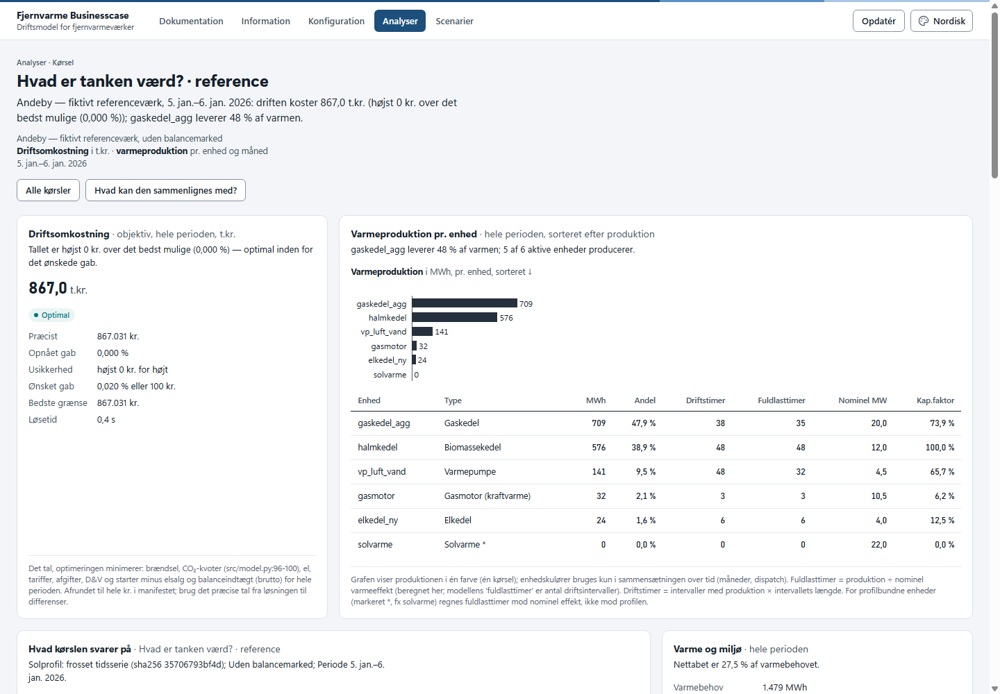
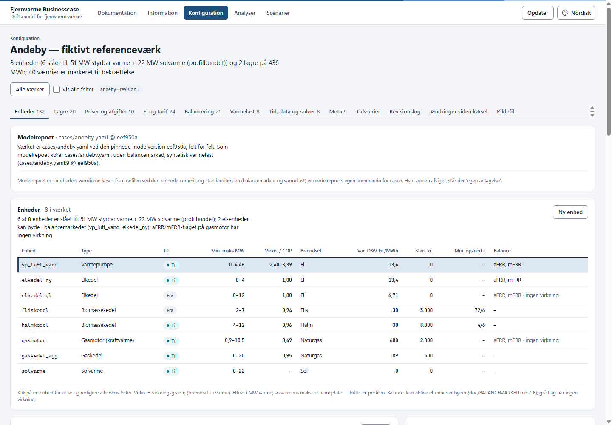
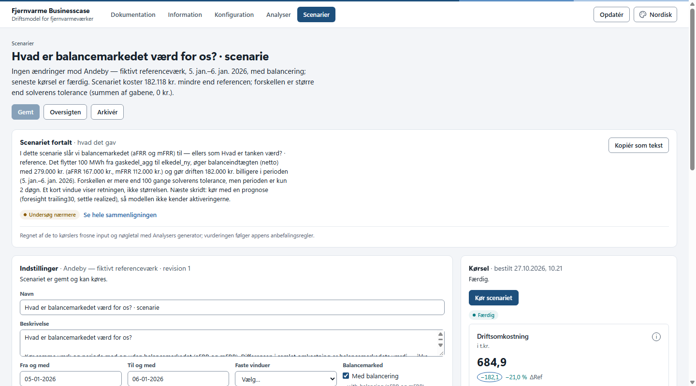
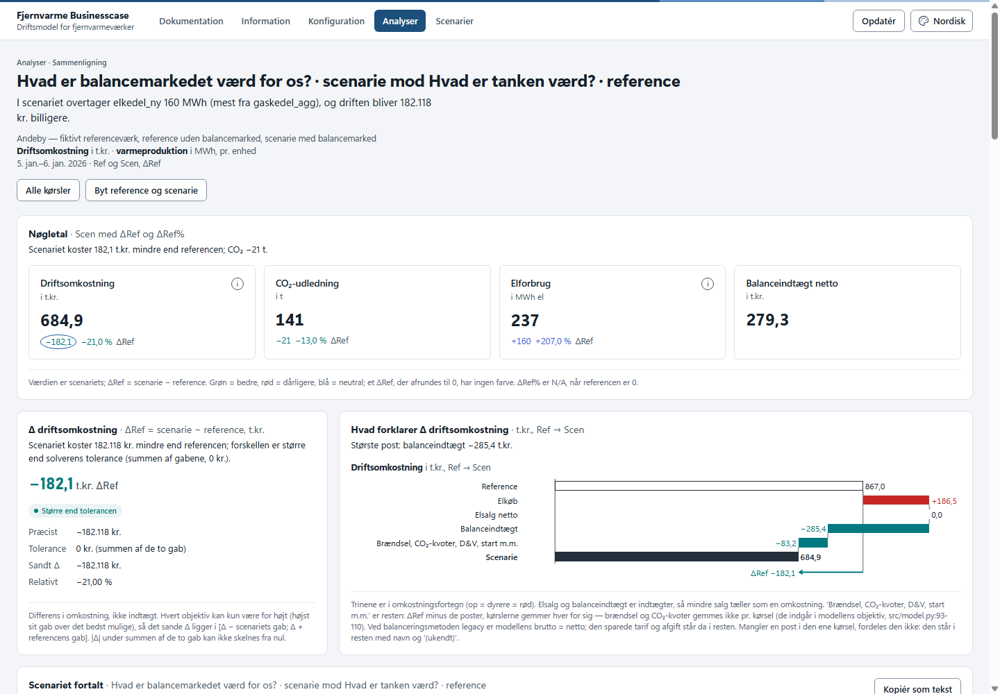

# Fjernvarme Businesscase — en brugerflade til den åbne driftsmodel

> En app til [`fjernvarme-businesscase`](https://github.com/skj-1964/fjernvarme-businesscase), den åbne MILP-driftsmodel
> for fjernvarmeværker af Steen Kramer Jensen (`skj-1964`), udviklet sammen med **Billund Varme** og **Dansk
> Fjernvarme** og frigivet under MIT-licens. Metoden, valideringen og referencetallene er forfatterens; appen gør
> modellen brugbar uden kommandolinje og kører den **uændret** på en pinnet commit. Der foreligger ingen godkendelse
> eller tilslutning fra modellens forfatter, Billund Varme eller Dansk Fjernvarme. Se [`CREDITS.md`](CREDITS.md).

Med appen kan du se og rette et værk (enheder, lagre, priser, tariffer, balancemarked), bestille kørsler af modellen
og læse resultaterne: nøgletal, enhedernes drift time for time, måned for måned og to kørsler side om side. Modellen
regner i baggrunden med de markeds- og vejrdata fra [`df-data`](https://github.com/skj-1964/df-data), den altid har
regnet med. Graferne følger IBCS® Standards.



| | | |
|---|---|---|
|  |  |  |
| *Konfiguration: Andeby, felt for felt, med kilden i modelrepoet* | *Scenarier: et scenarie fortalt og dets kørsel* | *Analyser: hvad er balancemarkedet værd for Andeby i to døgn?* |

---

## Hvad appen kan, og hvad den ikke kan

| Kan | Kan ikke |
|---|---|
| Vise og rette værker med revisionsspor; et nyt værk fra modellens regneark, fra en guide eller som kopi | Regne selv: alle tal kommer fra modellen; appen har ingen egen optimering |
| Bestille kørsler (et værk + ændringer + periode, med eller uden balancemarked), én solver ad gangen i kø | Køre modellen i browseren — den kræver Python, op til 3,5 GB hukommelse og minutter pr. kørsel |
| Sammenligne to kørsler (differensmetoden) og foreslå par, der besvarer et spørgsmål | Kvartersopløsning og perioder over 366 døgn (modellen kan begge dele) |
| Tage målt varmelast og solprofil ind som CSV, med tjek før kørslen | Det, modellen ikke kan: se modelrepoets [*Hvad modellen kan, og hvad den ikke kan*](https://github.com/skj-1964/fjernvarme-businesscase#hvad-modellen-kan-og-hvad-den-ikke-kan) |
| Vise modellens egne vejledninger og en forklaring af metoden | |
| Køre lokalt på én pc **eller** i Microsoft Fabric for en organisation | |

**To udgaver, samme app.** Samme sider, samme databaseskema og samme regnemotor:

| | **Lokal udgave** | **Fabric-udgave** |
|---|---|---|
| Hvad | en Python-server på din maskine, SQLite (eller din egen database), en lokal arbejder | en Fabric App med SQL-database, Entra-login og hosting; regnemotoren er en Python-notebook |
| Til | den enkelte ingeniør, et kursus, en afprøvning | en organisation med en Fabric-kapacitet |
| Kom i gang | [nedenfor](#kom-i-gang--lokal-udgave-520-minutter) og [`community/README.md`](community/README.md) | [`doc/FABRIC.md`](doc/FABRIC.md) |

---

## Kom i gang — lokal udgave (5–20 minutter)

**Du skal have:** Python **3.11–3.13**, Node.js **20 eller nyere** (kun til at bygge brugerfladen én gang), git og
netværk til GitHub. Windows, macOS eller Linux, og mindst 4 GB fri hukommelse. Det meste af tiden går med at hente
pakker (`npm ci` og `pip install`): fem minutter på en hurtig forbindelse, op til tyve på en travl maskine.

```bash
git clone https://github.com/DinSHS/fjernvarme-businesscase-app.git
cd fjernvarme-businesscase-app

# 1. Byg brugerfladen
cd app
npm ci
npm run build:community
cd ..

# 2. Et venv med appen og modellens pakker
python -m venv .venv
.venv/Scripts/python -m pip install setuptools            # macOS/Linux: .venv/bin/python i stedet for .venv/Scripts/python
.venv/Scripts/python community/pakke.py --ud _lokal/wheel
.venv/Scripts/python -m pip install "_lokal/wheel/fjernvarme_app-0.3.1-py3-none-any.whl[model]"

# 3. Start med modelrepoets cases som demo
.venv/Scripts/python -m fjernvarme_app --demo --data C:\fjv     # macOS/Linux: --data ~/fjv
```

Browseren åbner `http://localhost:8000`. Første start henter modelkoden og df-data på de pinnede commits (ca. 60 MB).

**Prøv en kørsel:** *Scenarier › Nyt scenarie fra et spørgsmål* → værket **Andeby** → spørgsmålet *Hvad er tanken værd?*
→ perioden *Egen periode*, 05-01-2026 til 06-01-2026 → *Bekræft og kør begge*. Appen bestiller to kørsler: referencen
(Andeby, som modelrepoet kører casen) og scenariet (uden tanke). Efter et par minutter (første gang henter den
data) står de under *Analyser*. Referencens driftsomkostning skal være **867.031,23 kr.** — samme tal som modellen selv
giver ved den pinnede commit.

* **Windows: datamappen skal have en kort sti** (`C:\fjv`). Modellens filnavne er lange, og Windows' grænse er 260 tegn.
* Uden `[model]` bygger appen selv et venv med modelrepoets `requirements.txt` ved første kørsel.
* Alle kommandoer og flag (egen database, port, eksport og import af værker): [`community/README.md`](community/README.md).

## Dit eget værk

Tre veje ind — **modellens regneark** (`vaerksdata_skabelon.xlsx`), **i appen** (kopi eller guide) eller **din egen
database** — og målte tidsserier som CSV bagefter. Se [`doc/EGNE_DATA.md`](doc/EGNE_DATA.md). Værkets data bliver på
din maskine.

## Fabric-udgaven

Til en organisation, der vil køre appen i Microsoft Fabric med Entra-login: [`doc/FABRIC.md`](doc/FABRIC.md). Alt
organisationsspecifikt (workspace-, database- og notebook-id'er, servernavn, eget tema) står i lokale, git-ignorerede
filer; gaten `python scripts/tjek.py` stopper det, hvis det alligevel er på vej ind i repoet
([`doc/SYNKRONISERING.md`](doc/SYNKRONISERING.md)).

## Regner appen som modellen?

Det er appens vigtigste krav, og det kan efterprøves: [`doc/TROFASTHED.md`](doc/TROFASTHED.md) viser pinnen,
modelspejlet, trofasthedstesten og beviset for, at appens vej giver samme objektiv og samme timefil som
`run_case.py` direkte for alle 7 cases — og lister de steder, hvor appen bevidst vælger selv (*egen antagelse*).

## Sådan må tallene bruges

Som i modelrepoet: **differenser frem for absolutte tal**, pr. marked og pr. produkt, og Spor A er en øvre grænse,
ikke en prognose. Et modeltal gælder for en periode, under nogle antagelser, med en metode. Appen viser
modelversionen og datagrundlaget på hver kørsel. Metoden forklaret: [`viden/METODE.md`](viden/METODE.md).

---

## Dokumentation

| Fil | Indhold |
|---|---|
| [`doc/EGNE_DATA.md`](doc/EGNE_DATA.md) | dit eget værk: værksark, i appen, SQL, CSV |
| [`community/README.md`](community/README.md) | den lokale udgave: kommandoer, egen database, arkitektur |
| [`doc/FABRIC.md`](doc/FABRIC.md) | Fabric-udgaven trin for trin, opdatering, fejlfinding |
| [`doc/TROFASTHED.md`](doc/TROFASTHED.md) | til modellens forfatter: sådan testes trofastheden |
| [`viden/METODE.md`](viden/METODE.md) | metoden bag appen og modellen, med kilder |
| [`skema/SKEMA.md`](skema/SKEMA.md) | databaseskemaet, bring your own SQL |
| [`community/API.md`](community/API.md) | den lokale servers REST-API |
| [`app/IBCS.md`](app/IBCS.md), [`app/TEMAER.md`](app/TEMAER.md) | notationen i graferne; temaer og eget tema |
| [`doc/SYNKRONISERING.md`](doc/SYNKRONISERING.md) | repoet er kilden: lokalt mod delt, gaten |
| [`CONTRIBUTING.md`](CONTRIBUTING.md), [`CLAUDE.md`](CLAUDE.md) | bidrag, tests, ny modelversion; vejledning til Claude Code |
| [`CHANGELOG.md`](CHANGELOG.md) | versioner, pins og hvad en opdatering kræver |

Modellens egne vejledninger (rapporten, `KOERSEL.md`, `EGET_VAERK.md`, `BALANCEMARKED.md` …) ligger i
[modelrepoet](https://github.com/skj-1964/fjernvarme-businesscase#dokumentation) og vises uændret i appen under *Dokumentation*.

## Struktur

```
fjernvarme-businesscase-app/
├── app/            # brugerfladen (React/Vite) for begge udgaver; app/rayfin/ = Fabric-udgavens backend (Rayfin)
├── community/      # den lokale udgave: Python-server, lokal arbejder, wheel (pakke.py)
├── fabric/         # regnemotoren (fjv/), fælles for begge udgaver; notebooks og udrulning til Fabric
├── skema/          # databaseskemaet (kontrakten), DDL, fælles testvektorer
├── viden/          # metode, tekster, regler, modelspejlet og værktøjerne til trofasthed (vaerktoej/)
├── offentlig/      # gatens regler og kreditfakta (tjek_offentlig.py)
├── scripts/        # tjek.py (gaten), installation.py (din Fabric-installation), pre-commit-hook
├── config/         # installation.eksempel.json; din egen installation.json er git-ignoreret
├── doc/            # vejledninger og skærmbilleder
├── noter/          # udviklingsnoter (historik, ikke vejledning)
├── LICENSES/       # modellens, datarepoets og IBCS-komponenternes licenser, ordret
└── CREDITS.md, NOTICE, LICENSE
```

`fjernvarme_data/`, `_lokal/`, `node_modules/` og `app/dist*/` oprettes ved brug og er git-ignoreret.

## Bidrag

Rettelser og forbedringer er velkomne. Den ene regel: **appen regner som modellen** — hvor den ikke gør, står der
*egen antagelse*. Se [`CONTRIBUTING.md`](CONTRIBUTING.md).

## Kredit og licens

- Appens kode: MIT — se [`LICENSE`](LICENSE).
- Modellen ([`fjernvarme-businesscase`](https://github.com/skj-1964/fjernvarme-businesscase), MIT © 2026 Dansk
  Fjernvarme) og datarepoet ([`df-data`](https://github.com/skj-1964/df-data), scripts MIT, data CC BY 4.0 fra
  Energinet og DMI): kredit, ordrette citater og pinnede commits i [`CREDITS.md`](CREDITS.md), licenserne ordret i
  [`LICENSES/`](LICENSES/). **Vi distribuerer ikke modellens kode**; appen henter den på den pinnede commit.
- IBCS-graferne bygger på `ibcs-web-charts` (MIT): [`LICENSES/ibcs-web-charts_LICENSE.txt`](LICENSES/ibcs-web-charts_LICENSE.txt).
  IBCS® er et registreret varemærke tilhørende IBCS Institute; appen følger IBCS Standards, men er ikke certificeret af
  eller tilknyttet IBCS Institute.
- Rayfin-app-skabelonen (Microsoft, MIT): [`app/LICENSE`](app/LICENSE).
